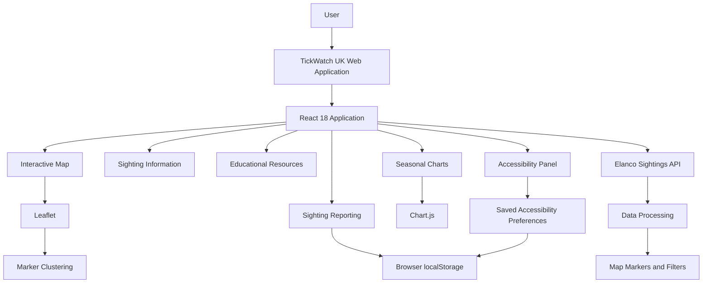
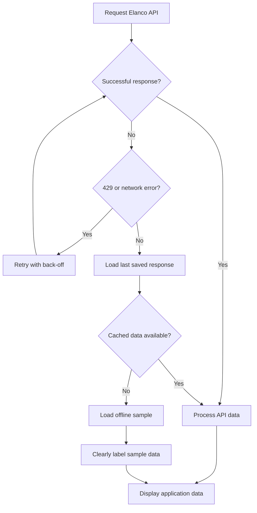

<div align="center">

# TickWatch UK ⏱️

### Explore. Identify. Protect.

**An interactive community-driven map of UK tick sightings, helping people explore tick activity, identify species, understand seasonal patterns and report sightings.**


*Developed for the Elanco Placement Programme : Frontend Technical Task.*

**Submitted by Mohammed Zuoriki**

</div>

---

## Table of Contents

1. [Overview](#overview)
2. [Project Objectives](#project-objectives)
3. [Key Features](#key-features)
4. [Application Experience](#application-experience)
5. [Technical Architecture](#technical-architecture)
6. [Technology Stack](#technology-stack)
7. [Data Sources and Methodology](#data-sources-and-methodology)
8. [Accessibility](#accessibility)
9. [Project Structure](#project-structure)
10. [Getting Started](#getting-started)
11. [Using the Application](#using-the-application)
12. [Data Handling and Resilience](#data-handling-and-resilience)
13. [Requirements Coverage](#requirements-coverage)
14. [Future Improvements](#future-improvements)
15. [Acknowledgements](#acknowledgements)
16. [Disclaimer](#disclaimer)

---

## Overview

**TickWatch UK** is an interactive web application designed to make UK tick sighting information more accessible, understandable and engaging.

The application provides a centralised map where users can explore reported tick sightings across the UK, investigate individual records, learn about different tick species and understand seasonal activity patterns.

Beyond visualising geographical data, TickWatch UK encourages community participation by allowing users to submit their own sightings, including photographs and additional information.

The application combines interactive mapping, data visualisation, educational resources and accessibility features within a responsive web experience.

### What can users do?

- **Explore:** Discover reported tick sightings across the UK through an interactive geographical map.
- **Investigate:** Select individual sightings to access location information and historical activity.
- **Understand:** Learn about tick species, identification and prevention through educational resources.
- **Analyse:** Explore seasonal trends through interactive charts.
- **Contribute:** Report new sightings, provide supporting information and upload photographs.
- **Customise:** Adjust accessibility settings to create a more comfortable browsing experience.

---

## Project Objectives

The application was developed around five main objectives:

| Objective | Description |
|---|---|
| **Geographical awareness** | Present tick sightings through an interactive UK map. |
| **Accessible information** | Make sighting information easy to explore and understand. |
| **Public education** | Provide species identification guidance and prevention advice. |
| **Community participation** | Enable users to submit their own tick sightings. |
| **Inclusive design** | Incorporate accessibility controls and keyboard-friendly interactions. |

The overall objective is to transform individual sighting records into an accessible and informative community resource.

---

## Key Features

### 1. Interactive UK Sightings Map

Explore tick sightings through an interactive map powered by Leaflet.

- Dynamic UK geographical map.
- Interactive sighting markers.
- Marker clustering to improve map readability.
- Activity-level visual indicators.
- Pulsing animations for recent sightings.
- Species initials displayed on markers.
- Interactive filters for:
  - Date range.
  - Tick species.
  - Activity level.
  - Recent sightings only.

### 2. Sighting Information Panel

Selecting a map marker opens a dedicated information panel containing relevant sighting information.

- Review individual sighting details.
- Explore the timeline of sightings within an area.
- Access reporting functionality.
- Get directions to a location.
- Share sighting information.

### 3. Tick Species Education

An educational section helps users become more familiar with different tick species.

- Species identification guidance.
- Relevant species information.
- Tick prevention tips.
- Educational content designed to support public awareness.

### 4. Seasonal Activity Visualisation

An interactive seasonal chart presents sighting patterns using Chart.js.

- City selection.
- Year selection.
- Seasonal activity comparisons.

This provides another way to understand how reported sightings vary over time and across locations.

### 5. Community Sighting Reports

Users can submit their own tick sightings directly through the application.

| Field | Description |
|---|---|
| Date | Date of the sighting. |
| Time | Approximate time of the sighting. |
| Location | Geographical location selected through the map. |
| Species | Selected tick species. |
| Notes | Additional information about the sighting. |
| Photograph | Image upload with preview functionality. |

The application also provides validation and user feedback through error, warning and success messages.

Submitted reports are stored locally in the browser using `localStorage`.

### 6. Customisable Accessibility Controls

An integrated accessibility panel allows users to personalise the interface.

- Text scaling (100%–175%).
- High-contrast mode.
- Greyscale mode.
- Atkinson Hyperlegible readable font.
- Adjustable line spacing.
- Adjustable letter spacing.
- Link highlighting.
- Enhanced keyboard focus indicators.
- Large cursor.
- Animation controls.
- Read-aloud functionality.
- Reset accessibility settings.

User preferences are retained between sessions.

---

## Application Experience

### Introduction Animation

The application features an animated Elanco introduction screen that runs when the page loads or refreshes.

- `#splash` element in `index.html`.
- Animation logic in `splash.js`.
- Animation styling in `styles.css`.

Once the animation completes, users are taken to the main dashboard containing the interactive map and filtering controls.

The animation automatically respects accessibility preferences, including:

- Pause animations.
- System-level `prefers-reduced-motion` settings.

### Navigation and User Interaction

The application provides an integrated experience connecting the map, sighting information, educational resources and reporting functionality.

The footer also includes GitHub and LinkedIn links, which open in new browser tabs and include appropriate screen-reader labels.

---

## Technical Architecture

TickWatch UK uses a lightweight frontend architecture built around React 18, with no traditional build process required.

The application loads its dependencies through CDN-hosted libraries and uses Babel Standalone to compile JSX directly in the browser.

### Architecture Overview



### Architectural Decision: No Build Step

Rather than introducing a traditional bundler and package-management workflow, TickWatch UK uses React's UMD distribution and Babel Standalone.

- No `npm install` is required.
- No Vite or Webpack configuration is required.
- No compilation command is required before running the application.
- The application can be served directly through a static web server.

All application dependencies are pinned to specific versions in `index.html` to provide predictable library loading.

### Application Workflow

1. **Initialisation:** The browser loads the application and its CDN-hosted dependencies.
2. **Introduction:** The Elanco animation is displayed, respecting the user's motion preferences.
3. **Data retrieval:** The application requests tick sighting records from the Elanco API.
4. **Data processing:** Records are transformed into map markers and supporting visual information.
5. **Exploration:** Users interact with the map, apply filters and investigate individual sightings.
6. **Reporting:** Users submit additional sightings, which are stored locally in the browser.
7. **Personalisation:** Accessibility preferences are saved and reapplied during subsequent visits.

---

## Technology Stack

| Category | Technology | Purpose |
|---|---|---|
| Frontend framework | React 18 | Component-based user interface. |
| JavaScript | JavaScript ES6+ | Application logic and interactivity. |
| JSX compilation | Babel Standalone | Compiles JSX directly in the browser. |
| Mapping | Leaflet | Interactive geographical map. |
| Marker clustering | Leaflet.markercluster | Groups map markers for improved readability. |
| Data visualisation | Chart.js | Seasonal activity charts. |
| Styling | CSS3 | Layout, animations, visual design and responsive styling. |
| Data source | Elanco API | Retrieves UK tick sighting records. |
| Local storage | Browser `localStorage` | Stores submitted reports and accessibility preferences. |
| Map tiles | OpenStreetMap / CARTO | Geographical map rendering. |

---

## Data Sources and Methodology

### Primary Data Source

The application retrieves tick sighting information from the public Elanco API.

**Endpoint:**

```http
GET https://dev-task.elancoapps.com/tick-sightings
```

The API provides the following information:

| Field | Description |
|---|---|
| `id` | Unique sighting identifier. |
| `date` | Date associated with the sighting. |
| `location` | City associated with the sighting. |
| `species` | Tick species. |
| `latinName` | Scientific name of the species. |

### Geographical Coordinates

The API provides city names rather than precise geographical coordinates. To display sightings on the map, the application:

1. Uses a predefined `CITIES` lookup table in `app.jsx`.
2. Associates each supported city with approximate city-centre coordinates.
3. Applies a small deterministic offset to individual records.

> **Important:** Map markers represent approximate city-centre locations rather than the exact geographical position where a tick was discovered.

### Activity-Level Calculation

Activity levels are categorised as **Low**, **Medium** or **High**. These classifications are derived from the number of sightings recorded in the same city during the 30 days preceding each individual sighting.

The application communicates this methodology through its interface.

### Recent Sightings

A sighting is classified as **Recent** when it falls within 14 days of the newest record available in the dataset.

This is a dataset-relative definition rather than a direct comparison against the current calendar date.

---

## Accessibility

Accessibility is incorporated throughout the application rather than treated as a separate visual feature.

### Accessibility Implementation

| Feature | Implementation |
|---|---|
| Skip navigation | Skip link for keyboard users. |
| Keyboard navigation | Keyboard-operable sighting lists and map markers. |
| Focus visibility | Strong and visible keyboard focus indicators. |
| Screen readers | Appropriate labels and `aria-live` updates. |
| Sidebar interaction | Escape key closes the sighting sidebar. |
| Form accessibility | Labelled input fields. |
| Motion preferences | Reduced-motion support. |
| Text customisation | Adjustable text size and spacing. |
| Visual accessibility | High contrast, greyscale and link highlighting. |
| Readability | Atkinson Hyperlegible font option. |
| Cursor visibility | Large cursor option. |
| Read-aloud | Browser speech functionality. |

### Preference Persistence

Accessibility preferences are stored in `localStorage` under the key `tw_a11y`.

Preferences are applied through `a11y-*` CSS classes on the HTML document. Additionally, `splash.js` reapplies saved preferences before the first page paint to minimise visual inconsistencies during loading.

---

## Project Structure

The project uses a lightweight file-based architecture.

```text
TickWatch-UK/
│
├── index.html
│   └── Main HTML entry point and external library dependencies
│
├── app.jsx
│   └── Main React application, components and application logic
│
├── styles.css
│   └── Application styling, responsive layouts and animations
│
├── splash.js
│   └── Introduction animation and accessibility preference handling
│
├── config.example.js
│   └── Example configuration for optional CARTO integration
│
├── config.js
│   └── Local configuration (git-ignored)
│
└── README.md
    └── Project documentation
```

| File | Responsibility |
|---|---|
| `index.html` | Application entry point and CDN dependency loading. |
| `app.jsx` | React components, map interactions, data processing, filtering and reporting. |
| `styles.css` | Visual design, layout, animations and accessibility styling. |
| `splash.js` | Introduction animation and early accessibility preference application. |
| `config.example.js` | Example configuration for optional map styling. |
| `config.js` | Local configuration containing optional CARTO credentials. |

---

## Getting Started

### Prerequisites

You only need a few tools to run TickWatch UK locally.

| Requirement | Description |
|---|---|
| Visual Studio Code | Recommended code editor. |
| Live Server | VS Code extension by Ritwick Dey. |
| Modern browser | Chrome, Firefox, Safari or Edge. |
| Internet connection | Required for external APIs, map tiles and CDN dependencies. |

### 1. Clone the Repository

```bash
git clone https://github.com/Code-tech77/<repository-name>.git
cd <repository-name>
```

Replace `<repository-name>` with the actual repository name. Alternatively, download the repository using GitHub's **Code → Download ZIP** option.

### 2. Open the Project

Open the project directory in Visual Studio Code:

```bash
code .
```

### 3. Install Live Server

1. Open the Extensions panel in VS Code.
2. Search for **Live Server**.
3. Install the extension by **Ritwick Dey**.

### 4. Launch the Application

1. Locate `index.html` in the project explorer.
2. Right-click the file.
3. Select **Open with Live Server**.

The application should open automatically in your default browser.

### 5. Optional: Configure CARTO Map Styling

The application supports optional CARTO basemap styling.

1. Obtain a free CARTO basemaps API key.
2. Copy `config.example.js`.
3. Rename the copied file to `config.js`.
4. Add your CARTO credentials to the configuration.

Without a CARTO key, the application automatically uses OpenStreetMap tiles. The local `config.js` file is git-ignored to prevent credentials from being committed to the repository.

### Alternative: Run Using Python

If you do not want to use Live Server, you can start a basic static server using Python:

```bash
python3 -m http.server 5500
```

Then open `http://localhost:5500` in your browser.

---

## Using the Application

The following workflow demonstrates the main user journey.

| Step | Action | Expected Result |
|---|---|---|
| 1 | Launch TickWatch UK. | Introduction animation and main dashboard. |
| 2 | Explore the map. | View geographical tick sighting markers. |
| 3 | Apply filters. | Narrow results by date, species, activity or recency. |
| 4 | Select a marker. | Open the sighting information panel. |
| 5 | Explore educational resources. | Learn about tick species and prevention. |
| 6 | View seasonal charts. | Investigate sighting patterns by city and year. |
| 7 | Submit a sighting. | Enter details and upload a photograph. |
| 8 | Customise accessibility. | Adjust the interface to personal preferences. |

---

## Data Handling and Resilience

TickWatch UK incorporates fallback mechanisms to maintain a usable experience when the external API is temporarily unavailable.

### API Reliability

The application follows a fallback sequence:



The application supports:

- Retry attempts with back-off for HTTP 429 rate limits.
- Retry attempts following network errors.
- Previously saved API responses as a fallback.
- An offline sample matching the API response structure.

When sample data is displayed, the interface clearly identifies it as offline sample data.

### User-Submitted Reports

Submitted sightings and their associated photographs are stored in browser `localStorage`. This provides local persistence without requiring a separate backend database.

> **Current limitation:** Reports are stored locally within the user's browser and are not synchronised across devices or shared with other users.

A production implementation could introduce:

- A dedicated backend API.
- SQL-based database storage.
- Object storage for uploaded photographs.
- User authentication and authorisation.
- Centralised report management.

---

## Requirements Coverage

The following table summarises the functionality delivered within the technical task.

| Requirement | Implementation |
|---|---|
| Interactive map | Dynamic UK map with clustered markers and activity-level indicators. |
| Sighting visualisation | Species initials, recent-sighting animations and interactive markers. |
| Map filtering | Date range, species, activity level and recent-only filters. |
| Sighting information | Interactive sidebar, area timeline, reporting, directions and sharing. |
| Educational resources | Species guide and prevention tips. |
| Seasonal analysis | Interactive chart with city and year selection. |
| Sighting reporting | Date, time, location, species, notes and photograph upload. |
| User feedback | Error, warning and success messages. |
| Accessibility | Keyboard navigation, screen-reader support and reduced-motion handling. |
| Accessibility customisation | Text scaling, contrast, greyscale, font, spacing and read-aloud options. |
| Data resilience | API retries, cached responses and offline sample data. |

---

## Future Improvements

Although the current implementation delivers the core frontend functionality, several improvements could extend the application further. These are potential extensions rather than features currently implemented.

| Priority | Improvement | Potential Benefit |
|---|---|---|
| High | Backend integration for community reports | Centralised and persistent sighting records. |
| High | SQL database integration | Structured storage and retrieval of submitted reports. |
| High | Cloud-based image storage | Scalable photograph management. |
| Medium | User authentication | Individual user accounts and report management. |
| Medium | More precise geographical reporting | Improved location accuracy beyond approximate city centres. |
| Medium | Advanced filtering and analytics | More detailed exploration of sighting trends. |
| Medium | Automated data refresh | More consistent updates from the external API. |
| Future | Mobile-first enhancements | Improved experience across mobile devices. |

---

## Acknowledgements

Special thanks to:

- **Elanco** for providing the technical task and public tick sightings API.
- **OpenStreetMap** for geographical map data.
- **CARTO** for optional basemap styling.
- **Leaflet** for its interactive mapping library.
- **Chart.js** for data visualisation capabilities.
- **React** for the frontend application framework.
- **Babel** for browser-based JSX compilation.

---

## Disclaimer

TickWatch UK is an educational and community-focused application developed as part of the Elanco Placement Programme frontend technical task.

Geographical coordinates are approximate, activity levels are derived from historical sighting counts, and recent sightings are calculated relative to the newest record in the dataset.

The application should not be treated as an authoritative source of medical advice, a definitive measure of tick prevalence or a substitute for professional guidance.

Elanco and its logo are trademarks of Elanco or its affiliates and are used here solely for this application task.

---

<div align="center">

**TickWatch UK**  Making tick sighting information more accessible through technology.

</div>
